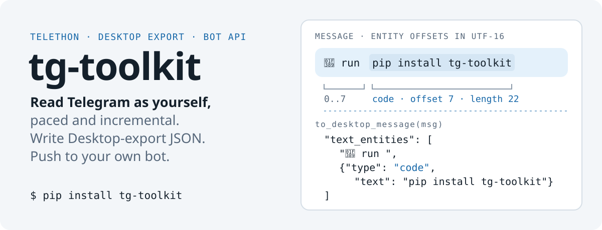
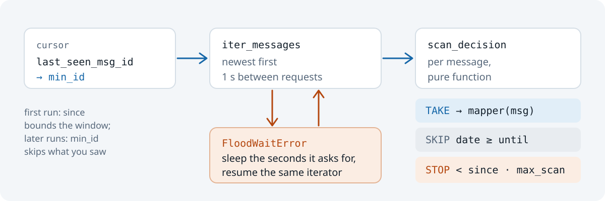

<p align="center">
  <picture>
    <source media="(max-width: 600px)" srcset="https://raw.githubusercontent.com/octrow/tg-toolkit/main/assets/readme/hero-mobile.svg">
    
  </picture>
</p>

<p align="center">
  <a href="https://github.com/octrow/tg-toolkit/actions/workflows/ci.yml"></a>
  <a href="https://pypi.org/project/tg-toolkit/"></a>
  <a href="https://pypi.org/project/tg-toolkit/"></a>
  <a href="https://github.com/octrow/tg-toolkit/blob/main/LICENSE"></a>
</p>

Read Telegram through your own account: paced, incremental, safe on FloodWait.
Convert messages to and from Telegram Desktop export JSON.

tg-toolkit is a small Python library on top of Telethon. It reads channels and chats with a pause between
requests, continues where the last run stopped, and sleeps through FloodWait instead of crashing.
It also sends plain-text pushes to your own bot.

It has three modules. Use any one without the others:

| module | needs telethon | what it does |
|---|---|---|
| `tg_toolkit.reader` | only when called | paced, incremental, bounded message reads |
| `tg_toolkit.export` | no | Telegram Desktop export, both directions |
| `tg_toolkit.push`   | no (stdlib `urllib`) | Bot API message and desktop `notify-send` |

## Install

```bash
pip install tg-toolkit
# or
uv add tg-toolkit
```

Python 3.12 or newer. Reading needs an `api_id` / `api_hash` from
[my.telegram.org](https://my.telegram.org) and a Telethon session. `export` and `push` need neither.

## First use

Collect new posts from a channel, only those since the last run:

```python
from tg_toolkit import last_seen_msg_id, read_messages, window_cutoff

def to_post(msg):
    text = (msg.message or "").strip()
    if not text:
        return None                       # returning None skips the message
    return RawPost(post_id=f"telegram:{handle}:{msg.id}", text=text, ...)

posts = read_messages(
    api_id=api_id, api_hash=api_hash, session=session, target=f"@{handle}",
    mapper=to_post,
    min_id=last_seen_msg_id(cursor),      # incremental
    since=window_cutoff(60),              # recency window, days
    max_scan=500,                         # backstop
    label=f"@{handle}",
    sort_key=lambda p: int(p.post_id.rsplit(":", 1)[-1]),   # last row = new cursor
)
```

More examples (several chats, live export, offline parse, push): [docs/usage.md](docs/usage.md).

## What you get back

A message with an emoji and a code entity, run through `to_desktop_message` (output from the test fakes):

```python
>>> to_desktop_message(msg)["text_entities"]
['🎉 run ', {'type': 'code', 'text': 'pip install tg-toolkit'}]
```

Telegram counts entity offsets in UTF-16 code units, and the party popper takes two of them.
Slicing the Python string at offset 7 would cut one character too far.
`export` slices through `utf-16-le`, so the code span comes out whole.

## How the reader works

<p align="center">
  <picture>
    <source media="(max-width: 600px)" srcset="https://raw.githubusercontent.com/octrow/tg-toolkit/main/assets/readme/scan-loop-mobile.svg">
    
  </picture>
</p>

- Uses your user session, never a bot token. A bot can't read arbitrary channels or your own dialogs.
- Pauses 1 second between requests (`wait_time=1.0`), under Telegram's limit.
- On a long `FloodWaitError`, `iter_flood_safe` sleeps the asked time and resumes the same iterator.
- Scans newest-first and stops at `since` or `max_scan`, so a first run is not a full backfill.
- Resumes by `min_id`. A broken cursor becomes `0` (a windowed scan) instead of an error.

Full list of reader, export and push rules: [docs/behavior.md](docs/behavior.md).
Step-by-step flows: [docs/logic-map.md](docs/logic-map.md).

## Limits

- Export entities that overlap or nest are skipped, not merged.
- Push is best-effort: failures are logged, never raised. Send only to your own private chat with the bot.
- `export` matches Telethon objects by class name. Exotic subclasses take the `user` / `group_chat` branch.

## More

- [docs/api.md](docs/api.md): every public function with its signature.
- [docs/usage.md](docs/usage.md): examples for each module.
- [docs/behavior.md](docs/behavior.md): rules, test notes, and notes for the projects it was extracted from.
- [CHANGELOG.md](CHANGELOG.md), [CONTRIBUTING.md](CONTRIBUTING.md)

## Tests

```bash
uv sync --extra dev && uv run pytest -q
```

No network, no session file, no real `TelegramClient`.

## License

[MIT](https://github.com/octrow/tg-toolkit/blob/main/LICENSE)
