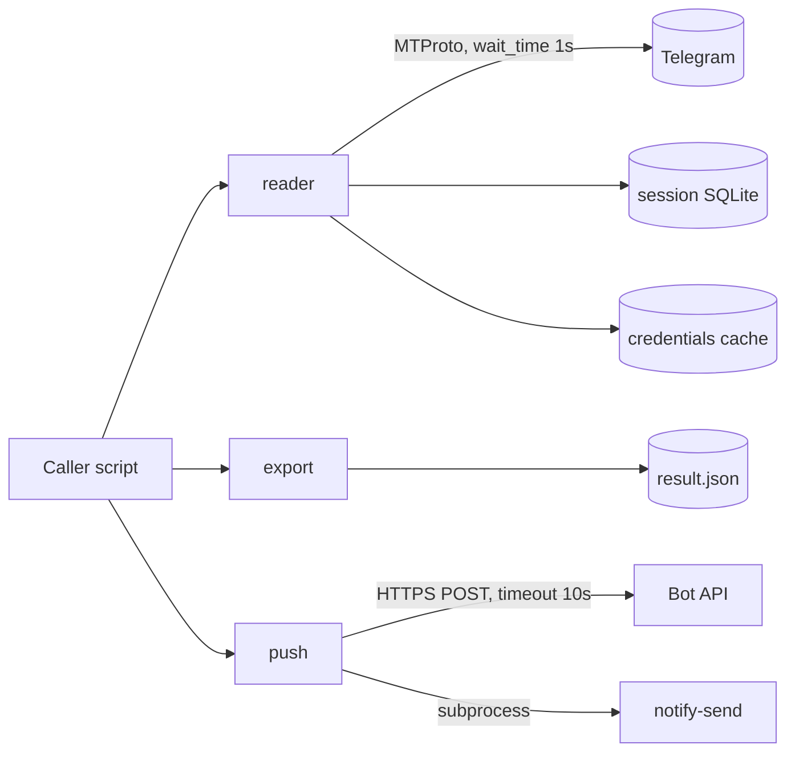

# System design review: tg-toolkit

Kind: library (3 independent modules, no server, no CLI). Steps 3 (API contract as endpoints) and the cache part of 5 are n/a.
Stack, flows and per-step findings: [logic-map.md](logic-map.md). Not repeated here except where it is a scaling or failure risk.

## Assumptions

- Users: 1 (the owner), through callers in other repos (chat-watch, jobs-style scrapers). Assumed, no DAU concept applies.
- Typical call: one chat, incremental `min_id`, tens of new messages per run. Assumed.
- Worst call: a bare `collect`/`scan_messages` on a large chat: full history (logic-map "Entry points"). Assumed 100k messages. `read_messages` is bounded by default (60 days, 500 messages).
- Telethon `iter_messages` page size = 100 messages per GetHistory request. Assumed from Telethon 1.x defaults; logic-map A5 also cites a 100-message chunk.
- Telegram limit ~30 s / 10 requests per chat for history, Telethon sleeps FloodWait up to 60 s itself. Quoted in `src/tg_toolkit/reader.py:18` and logic-map A2.
- No numbers from logs or a DB exist: the library keeps no state apart from a session SQLite and an optional credentials cache.

Measured (source):
- 694 lines in `src/tg_toolkit/*.py` (`wc -l`): reader 272, export 200, push 129, `__init__` 93.
- 25 commits, last 2026-11-05 (`git log`).
- Defaults `wait_time=1.0`, `DEFAULT_MAX_SCAN=500` (defined `reader.py:50`, applied by default only in `read_messages`, logic-map entry points).

## 0. What exists

- Rung today: 1 (single process, in-process library, runs inside the caller). Nothing to deploy.
- Reader: sync Telethon client opened and closed per call; Telegram is the only external dependency and the slowest one.
- Export: pure CPU, in-memory JSON; push: Bot API POST in a daemon thread plus `notify-send` subprocess.
- State on disk: `<session>.session` (SQLite, Telethon-owned), optional credentials cache (0600), written export JSON.

## 1. Requirements

One sentence: let personal tools read a Telegram chat incrementally, convert to/from Desktop exports and push notifications, without owning a server.

Functional (core): live read with cursor (A1-A7), Telethon-to-Desktop export (B1-B3), parse exports to rows (B4), push to phone/desktop (C1-C4).
Out of scope: sending as a user, media download, multi-account orchestration, retries across runs (callers own cursors).

Non-functional (assumed):
| NFR | Target |
|---|---|
| Scale | 1 user, <=10 chats, a run every few minutes at most |
| Latency | incremental run <10 s; full-history scan allowed minutes, must be bounded |
| Availability | best effort; a failed run is retried by the caller's next run |
| Consistency | cursor never skips messages (see Risks) |
| Durability | nothing stored here is precious: session and credentials are re-creatable |
| Security | api_hash and bot token never logged (token masked in `bot_send`); cache 0600 |
| Observability | logging only; no metrics |

## 2. Napkin math

The napkin script models request-serving traffic. Here the "requests" are Telegram GetHistory chunks.

Incremental run (50 chunks/day is far above real need):
```
$ napkin.py --dau 1 --req-per-user 50 --peak 3 --server-rps 1
requests/day ... 50   average ... 0.0 req/s   peak (x3) ... 0.0 req/s
storage per year ... 10.9MB   egress at peak ... 25bit/s
verdict: rungs 1-2: one good VPS. Ship it.
```
Heavy case, 1000 chunks/day (one full 100k-message scan):
```
$ napkin.py --dau 1 --req-per-user 1000 --peak 1 --server-rps 1
requests/day ... 1.0k   average ... 0.0 req/s
```
Hand-derived from the constants above (assumed, not measured): 100k messages / 100 per chunk = 1000 chunks; at `wait_time` 1.0 s per chunk that is about 17 min of pure sleep, before any FloodWait. The load is trivially low; the cost is wall-clock time and Telegram limits, not capacity.

## 3. API contract

Public API is `src/tg_toolkit/__init__.py` (`__all__`), listed in logic-map "Entry points". n/a as HTTP.
Contract gaps that matter for callers: `collect` returns a bare list, with no flag that `max_scan` truncated it, only a log warning naming the chat and the limit (logic-map A6, #10).

## 4. High-level architecture

Rung 1: library inside the caller's process. No new boxes.



Each box: Telegram is the data source; session SQLite is Telethon's own entity/auth cache; push threads keep the caller from blocking on the Bot API.
No queue, DB or cache is justified: single user, caller-owned cursors.

## 5. Data

No database. Cursor state belongs to callers (`last_seen_msg_id` only parses it, A4). The session SQLite is single-writer: two concurrent callers on the same `<session>.session` hit `database is locked` (assumed from Telethon/SQLite behaviour, not reproduced). Give each caller its own session file.
Cache: n/a (the only cache is the credentials file; invalidation is manual, and it shadows env, A1).

## 6. Scale and failure

- x10 traffic: still 0.0 req/s. First thing to saturate is Telegram's per-chat limit: 10x more chunks per minute means FloodWait sleeps, not CPU. Each wait is up to 60 s inside Telethon (A2) or `exc.seconds` in `iter_flood_safe` with no cap (`reader.py:178-194`).
- Telegram slow or down: Telethon connect errors propagate (A5 "any other error"); no timeout on the scan as a whole, only `max_scan`, which only `read_messages` applies by default (500).
- Bot API takes 8 s: within `timeout=10`, in a daemon thread, caller unaffected. Over 10 s: logged, returns False, message lost (no retry).
- `notify-send` hangs: `push.py:84` has no timeout, `notify` blocks the caller indefinitely (#2).
- Retries/backoff: only FloodWait sleep. No retry on push, no circuit breaker; acceptable for notifications.
- Process crash mid-scan: nothing persisted; caller re-reads from its stored `min_id`. Safe only if the caller advances the cursor after success (see Risks).
- Backups: n/a; session and credentials are regenerable (one interactive login).

## 7. Trade-offs

- Sync Telethon (`telethon.sync`) over asyncio: simple scripts, but blocks, and cannot overlap chats within a process.
- Client per call: no leaked connections, but each call pays connect + auth handshake and can trigger interactive login.
- Duck-typed export (no telethon import): export stays installable and testable alone, but breaks silently on class renames (B1-B3).
- Fail-open cursor parse (A4): never loses data, but a corrupt cursor triggers a full windowed scan.
- Fire-and-forget push: no latency cost, but no delivery guarantee.

## 8. Summary

- Design: three stateless helper modules around Telethon and Bot API; correct at rung 1, nothing to add.
- Would change if wrong: many chats per run (then share one client and go async), concurrent callers (separate or locked sessions), chats with 100k+ messages scanned unbounded.
- Next rung: shared async client / per-chat scheduling when a caller's runs for one chat overlap or a run exceeds its schedule interval (trigger: wall-clock per run > 50% of the run interval, or repeated FloodWait > 60 s in logs).

## Risks

- MEDIUM: bare `collect`/`scan_messages` have no default bound by design (only `read_messages` applies `DEFAULT_MAX_SCAN=500` and a 60-day `since`, `src/tg_toolkit/reader.py`), so a caller that opens its own client and passes neither does a full-history scan on a large chat (~17 min at 100k messages, assumed) and invites FloodWait. See logic-map "Entry points".
- HIGH: truncation by `max_scan` is visible only as a log warning (chat id and limit), not in the result; storing the last row id as next `min_id` skips messages permanently (`reader.py` `scan_messages`/`collect`, logic-map #10).
- MEDIUM: `iter_flood_safe` sleeps `exc.seconds` with no cap or repeat limit (`reader.py:178-194`); a long ban stalls a caller for hours.
- MEDIUM: `flood_sleep_threshold` is set on the session where Telethon ignores it (`reader.py:99`, #8); the effective 60 s threshold hides waits from `iter_flood_safe`.
- MEDIUM: `subprocess.run` without timeout blocks `notify` (`src/tg_toolkit/push.py:84`, #2).
- MEDIUM: shared `<session>.session` across concurrent callers can lock (assumed, `reader.py` make_client).
- LOW: `O_TRUNC` on the credentials cache before validation can leave an empty cache (`reader.py:70`, #9).
- LOW: `bot_send` has no retry; one transient failure drops the alert (`push.py`, C1).
